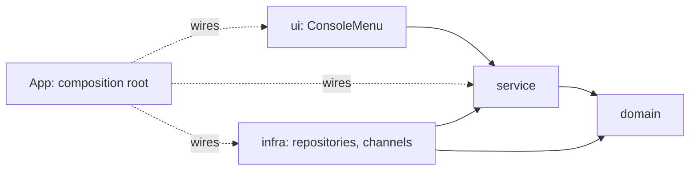

# Smart Dormitory Services

Capstone project for *Application Design Based on Patterns* (topic 7). A console information system for a
student dormitory: **room requests, maintenance tickets, visitor log, announcements**.

## Run

```bash
mvn verify                          # tests + architecture rules + 60% coverage gate
mvn -q exec:java                    # in-memory storage
mvn -q exec:java -Dexec.args="--storage=file --data=data"   # file storage, survives restarts
```
In VS Code: open `App.java` and press **F5**. Requires Java 17+ and Maven.

Demo script: `1` register student → `2` request room → `3` undo it → `15` switch role to STAFF →
`5` report problem → `6/7/8` assign, start, resolve → `13` post announcement (watch two channels fire).

## Domain
* **Room request** – a student asks for a bed; a *strategy* picks the room; the action is undoable.
* **Maintenance ticket** – OPEN → ASSIGNED → IN_PROGRESS → RESOLVED; only staff may change it.
* **Visitor log** – arrivals/departures; list who is still inside.
* **Announcements** – posted once, delivered through every notification channel.

## Architecture

Dependencies point inward and are enforced by `ArchitectureTest` (ArchUnit).
`App` is the only class that creates concrete objects (no Singleton, see ADR-0006).

| Package | Contains |
|---|---|
| `domain` | Entities, `Repository` port, State, Memento, Builder, Iterator, event types |
| `service` | Use cases, Strategy, Command, Observer, Proxy, Decorator, Factory Method base |
| `infra` | In-memory and file repositories, console and SMS channels (Adapter) |
| `ui` | `ConsoleMenu` – calls services only |

## Patterns used (details: [docs/PATTERN_REGISTER.md](docs/PATTERN_REGISTER.md))
Factory Method, Builder, Adapter, Decorator, Proxy, Observer, Command, Memento, State, Strategy, Iterator
(11 patterns; combinations: Command + Memento, Factory Method + Decorator). Rejected: Singleton, Visitor, Facade.

## Extension points
* **New notification channel** → one new `ChannelFactory` subclass (see `ExtensionPointTest`).
* **New allocation rule** → one new `RoomAllocationStrategy` class.
* **Undo** → `AssignRoomCommand` + `Room.Memento`, proven in `RoomUndoTest`.

## Libraries
JUnit 5, ArchUnit, JaCoCo (test/build only). No library implements a pattern for us.

## Documents
`docs/USER_STORIES.md`, `docs/PATTERN_REGISTER.md`, `docs/adr/`, `docs/TEAM_WORKFLOW.md`, `docs/DEFENCE_PREP.md`.
