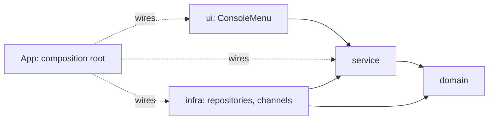

# Smart Dormitory Services


Capstone project for *Application Design Based on Patterns* (topic 7). A secure web and console information system for a
student dormitory: **student records, room requests, maintenance tickets, visitor log, announcements**.

## Run the website (recommended)
```bash
python3 scripts/setup_env.py       # once: creates the private .env (passwords + encryption key). Never commit it.
bash scripts/run-web.sh            # website + REST API + SQLite database on http://localhost:8080
# or:  mvn -q compile exec:java -Dexec.args="--web --storage=sqlite --data=data"
```
Sign in with `admin`, `staff` or `student`; the passwords are inside your `.env` file.
In GitHub Codespaces, click **Open in Browser** in the popup, or open the **Ports** tab and the forwarded address of port 8080.
The three accounts see different data: **admin** manages students (IIN, date of birth, passport no., national ID, contacts...), **staff** sees students with identity numbers masked and handles repairs, **student** sees only the directory. Details: [`docs/SECURITY.md`](docs/SECURITY.md).
The REST API is documented in [`docs/API.md`](docs/API.md); the committee checklist is [`docs/REQUIREMENTS_CHECKLIST.md`](docs/REQUIREMENTS_CHECKLIST.md).

## Run (tests and console version)

```bash
mvn verify                          # tests + architecture rules + 60% coverage gate
mvn -q exec:java                    # in-memory storage
mvn -q exec:java -Dexec.args="--storage=file --data=data"     # file storage
mvn -q exec:java -Dexec.args="--storage=sqlite --data=data"   # SQLite database data/dorm.db
```
In VS Code: open `App.java` and press **F5**. Requires Java 17+ and Maven.

Demo script: `1` register student → `2` request room → `3` undo it → `15` switch role to STAFF →
`5` report problem → `6/7/8` assign, start, resolve → `13` post announcement (watch two channels fire).

## Continuous integration and database (quick answers)
* **CI:** [`.github/workflows/ci.yml`](.github/workflows/ci.yml). It runs `mvn verify` (tests, ArchUnit rules, 60% coverage gate) on every push and pull request. Results: the **Actions** tab; the badge above shows the status.
* **Database:** SQLite through JDBC. Schema: [`src/main/resources/schema.sql`](src/main/resources/schema.sql) (6 tables, keys, constraints, a view). ER diagram: [`docs/DATABASE.md`](docs/DATABASE.md). Code: `infra/SqliteDatabase`, `infra/SqliteRepositories`. Demo data: [`docs/sample_data.sql`](docs/sample_data.sql). The file `data/dorm.db` is created when the app runs with `--storage=sqlite` (it is not committed to Git).

## Domain
* **Room request** – a student asks for a bed; a *strategy* picks the room; the action is undoable.
* **Maintenance ticket** – OPEN → ASSIGNED → IN_PROGRESS → RESOLVED; only staff may change it.
* **Visitor log** – arrivals/departures; list who is still inside.
* **Announcements** – posted once, delivered through every notification channel.

## Architecture

Dependencies point inward and are enforced by `ArchitectureTest` (ArchUnit).
`App` is the only class that creates concrete objects (no Singleton, see ADR-0006).

| Package | Contains |
|---|---|
| `domain` | Entities, `Repository` port, State, Memento, Builder, Iterator, event types |
| `service` | Use cases, Strategy, Command, Observer, Proxy, Decorator, Factory Method base |
| `infra` | In-memory and file repositories, console and SMS channels (Adapter) |
| `ui` | `ConsoleMenu` – console interface, calls services only |
| `web` | REST API (`Api`), HTTP server, JSON; the website files are in `src/main/resources/web` |

## Patterns used (details: [docs/PATTERN_REGISTER.md](docs/PATTERN_REGISTER.md))
Factory Method, Builder, Adapter, Decorator, Proxy, Observer, Command, Memento, State, Strategy, Iterator, Template Method
(12 patterns; combinations: Command + Memento, Factory Method + Decorator). Rejected: Singleton, Visitor, Facade.

## Extension points
* **New notification channel** → one new `ChannelFactory` subclass (see `ExtensionPointTest`).
* **New allocation rule** → one new `RoomAllocationStrategy` class.
* **Undo** → `AssignRoomCommand` + `Room.Memento`, proven in `RoomUndoTest`.

## Libraries
JUnit 5, ArchUnit, JaCoCo (test/build only), sqlite-jdbc (runtime, database driver). Encryption and password hashing use the JDK itself (`javax.crypto`). No library implements a pattern for us.

## Documents
`docs/API.md`, `docs/SECURITY.md`, `docs/REQUIREMENTS_CHECKLIST.md`, `docs/RESEARCH.md`, `docs/UML.md` (8 diagrams), `docs/DATABASE.md` (ER diagram, schema), `docs/DB_DEMO.md` (database demo script), `scripts/show-db.py`, `docs/USER_STORIES.md`, `docs/PATTERN_REGISTER.md`, `docs/adr/`, `docs/TEAM_WORKFLOW.md`, `docs/DEFENCE_PREP.md`.
