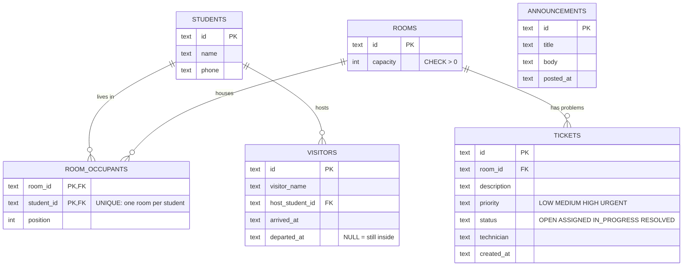

# Database design

The system stores data behind the `Repository` interface. Three implementations exist:
`InMemoryRepository` (tests, demo), `FileRepository` (Java serialisation) and the **SQLite** repositories
(relational database through JDBC). Start with `--storage=sqlite`; the file is `data/dorm.db`.

## ER diagram


## Design decisions
* **Normalisation (3NF):** occupants are not a list inside `rooms`; they are rows of `room_occupants`. A student appears in one place only.
* **Business rules in the schema:** `UNIQUE(student_id)` means a student cannot have two rooms even if the code had a bug; `CHECK` constraints limit priority and status values; foreign keys block tickets for unknown rooms and visitors for unknown hosts (`PRAGMA foreign_keys = ON`).
* **NULL means something:** `departed_at IS NULL` is a visitor who is still inside.
* **Dates** are stored as ISO-8601 text, which sorts correctly and needs no driver-specific types.
* **Why no database in the domain:** the domain and service layers do not import `java.sql`. Only `infra` does (checked by `ArchitectureTest`).
* **Why SQLite:** no server to install, one file, full SQL and transactions, so tests run offline. A server database (PostgreSQL) would only need new classes behind the same interface.

## Example queries the schema supports
```sql
-- free beds per room
SELECT r.id, r.capacity - COUNT(o.student_id) AS free_beds
FROM rooms r LEFT JOIN room_occupants o ON o.room_id = r.id GROUP BY r.id;

-- open urgent tickets
SELECT id, room_id, description FROM tickets WHERE priority = 'URGENT' AND status <> 'RESOLVED';

-- visitors still inside
SELECT visitor_name, host_student_id, arrived_at FROM visitors WHERE departed_at IS NULL;
```
