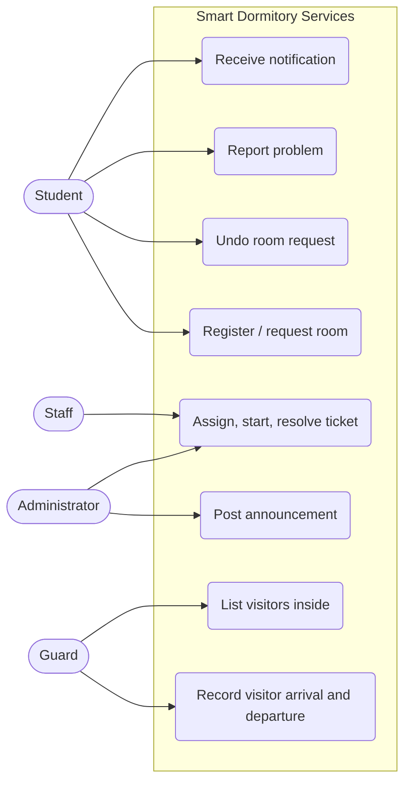
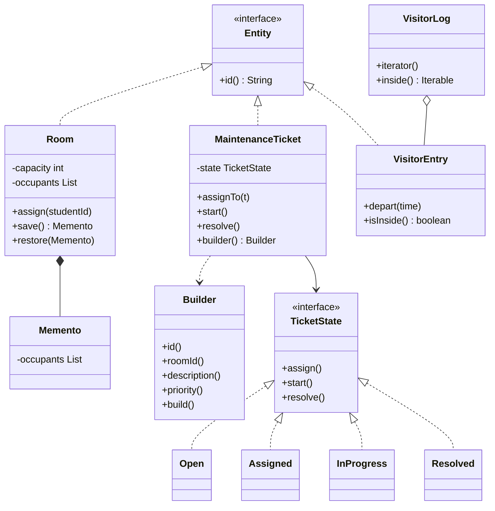
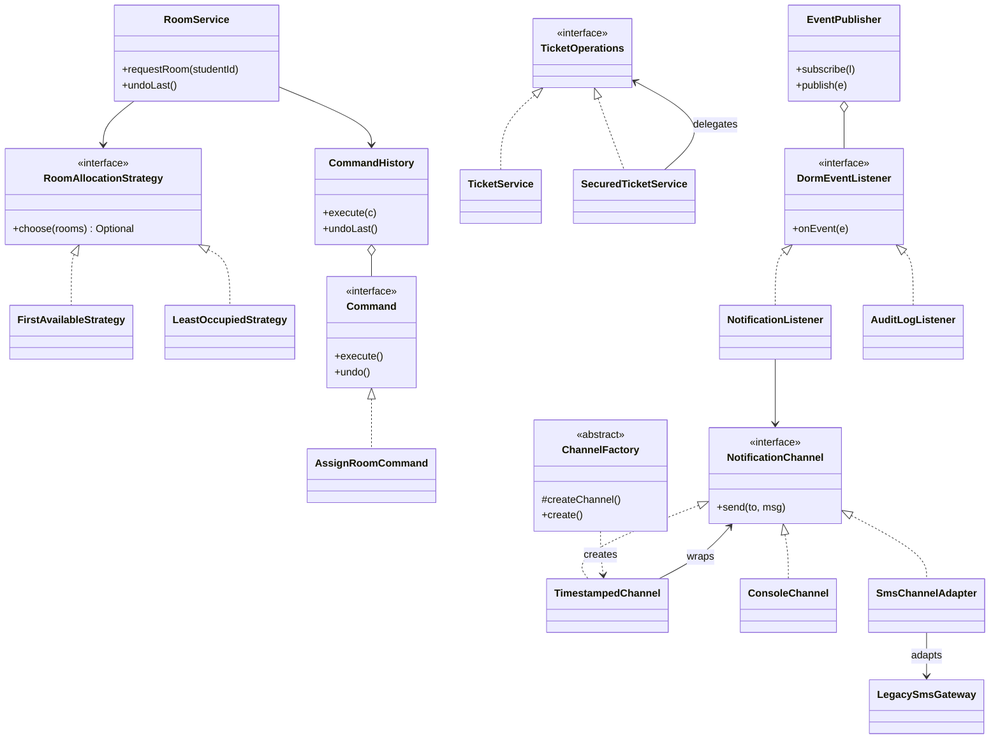
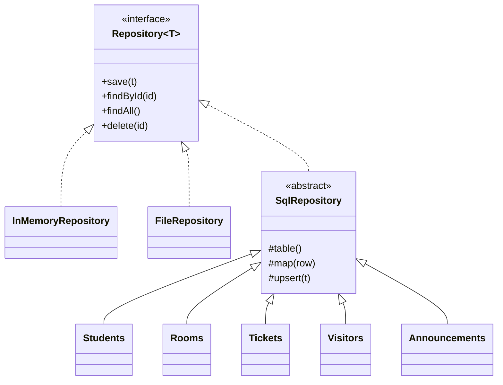
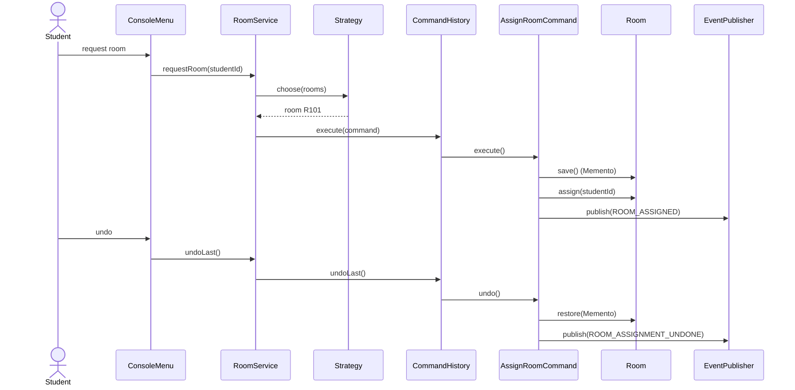
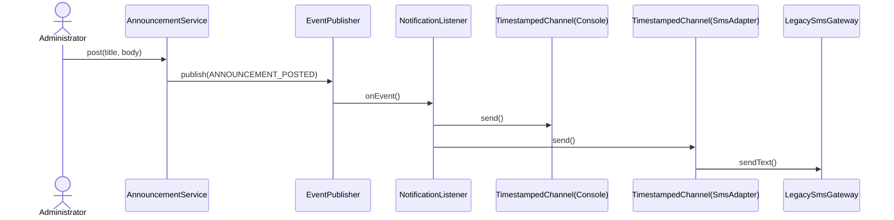
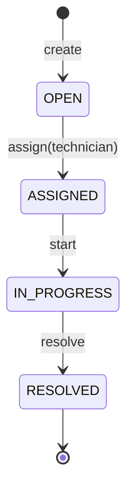
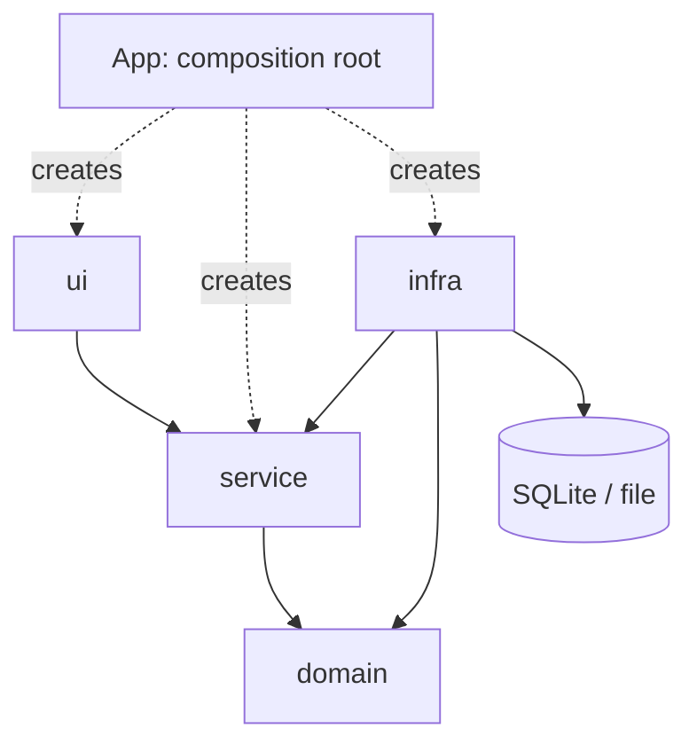

# UML diagrams

All diagrams are Mermaid, so GitHub draws them directly. In VS Code use the *Markdown Mermaid* extension.

## 1. Use case diagram

## 2. Class diagram: domain and state (State, Memento, Builder, Iterator)

## 3. Class diagram: services and patterns (Command, Strategy, Proxy, Observer, Factory Method, Decorator, Adapter)

## 4. Class diagram: persistence (Repository, Template Method)

## 5. Sequence diagram: request a room and undo (Strategy + Command + Memento + Observer)

## 6. Sequence diagram: announcement reaches all channels (Observer + Factory Method + Decorator + Adapter)

## 7. State diagram: maintenance ticket (State)

## 8. Component / layer diagram

The entity-relationship diagram is in [DATABASE.md](DATABASE.md).
